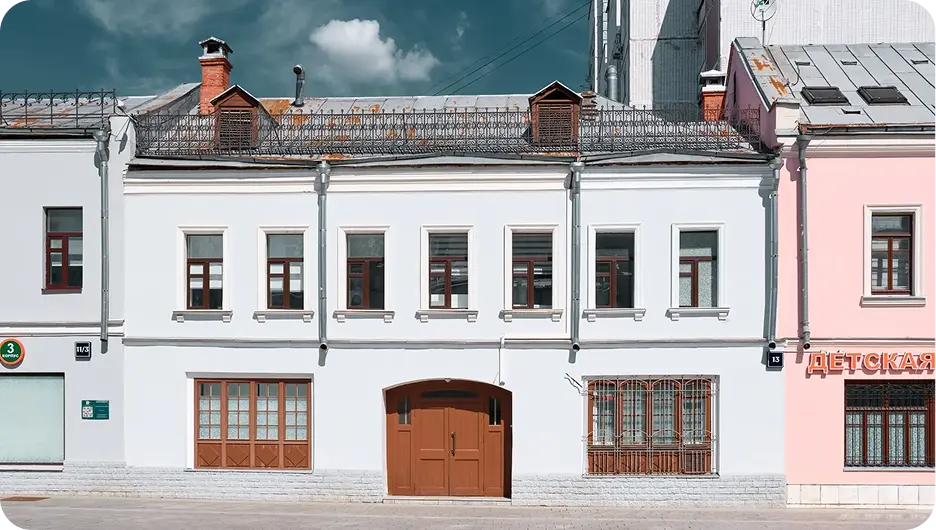
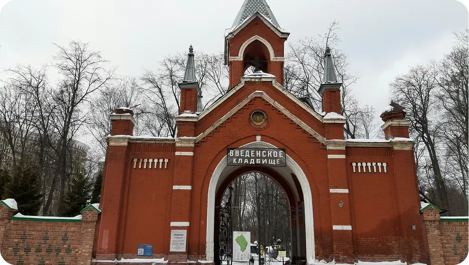

Два необычных места в столице, где мне нравится бывать:

улица Школьная — отреставрированные дома Рогожской ямской слободы выглядят очень симпатично, будто переносишься на века назад

Введенское кладбище — потрясающий кусочек истории со старинными захоронениями, а летом тут невероятно красиво — повсюду цветёт жасмин
