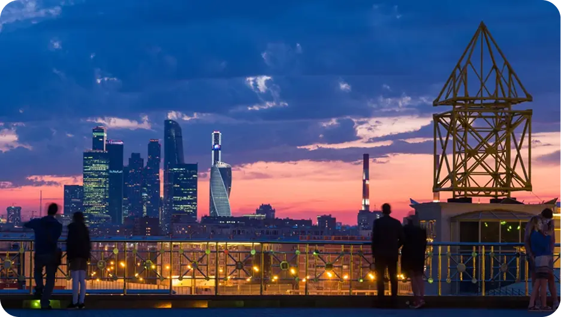
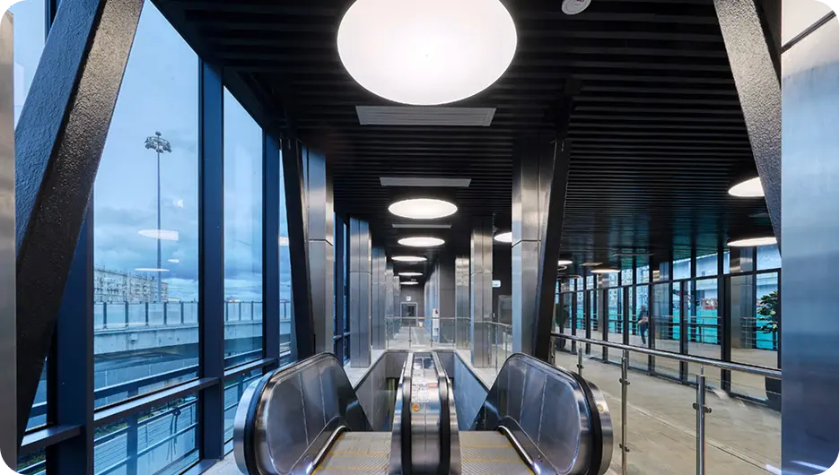
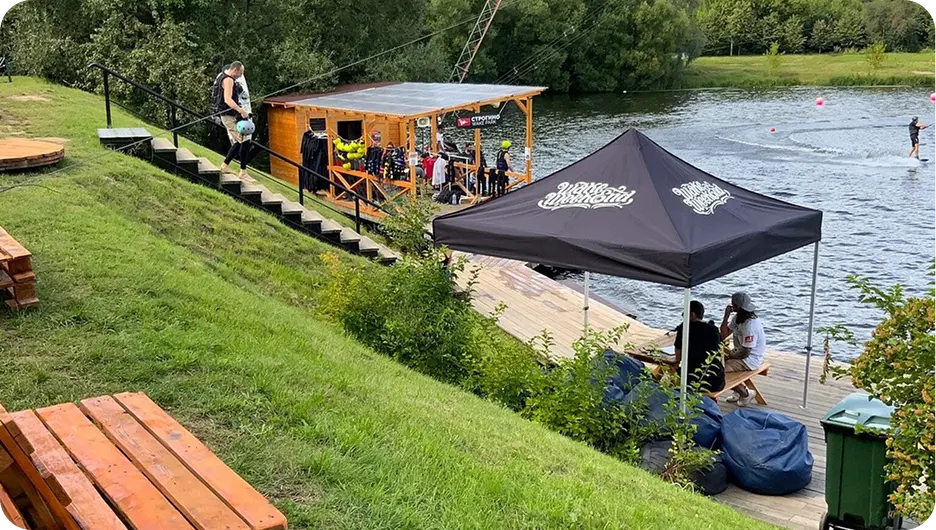

Достопримечательностей много, но тут хочу поделиться своими любимыми:

Смотровая площадка около РАН — классный вид на город, хочется просто стоять и любоваться

Путь от метро «Кутузовская» до «Смоленской» — отличная прогулка

Парк Строгино — спокойное место, где легко выдохнуть и почувствовать, что большой город может быть не только шумным
