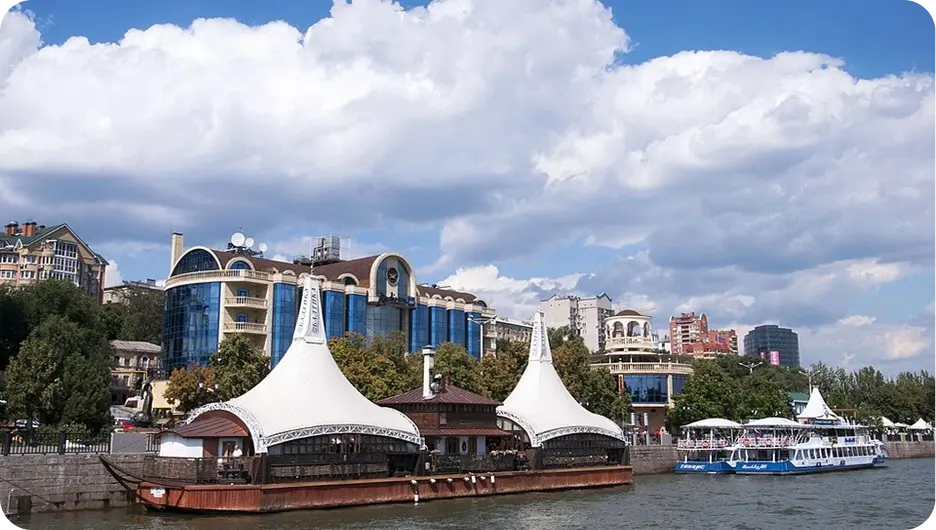
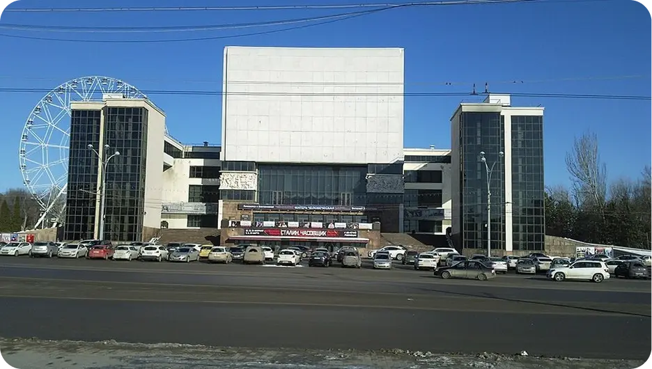
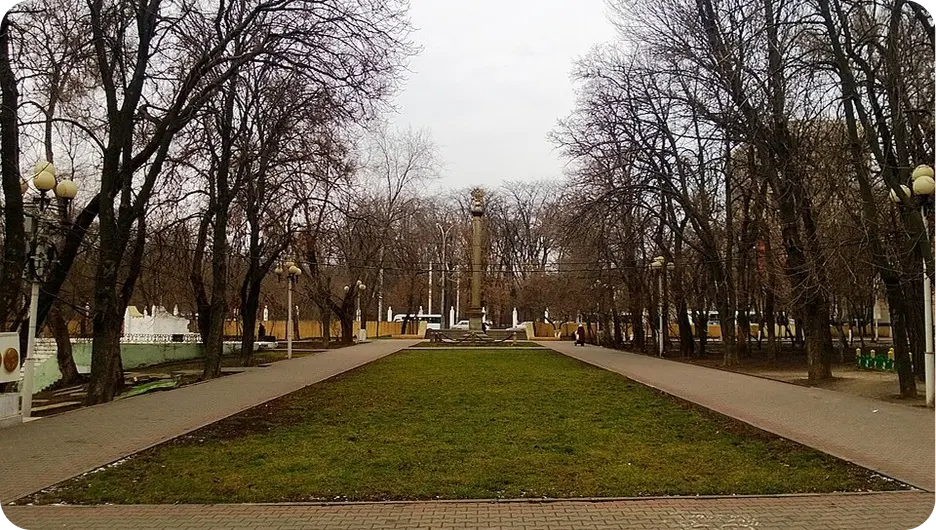
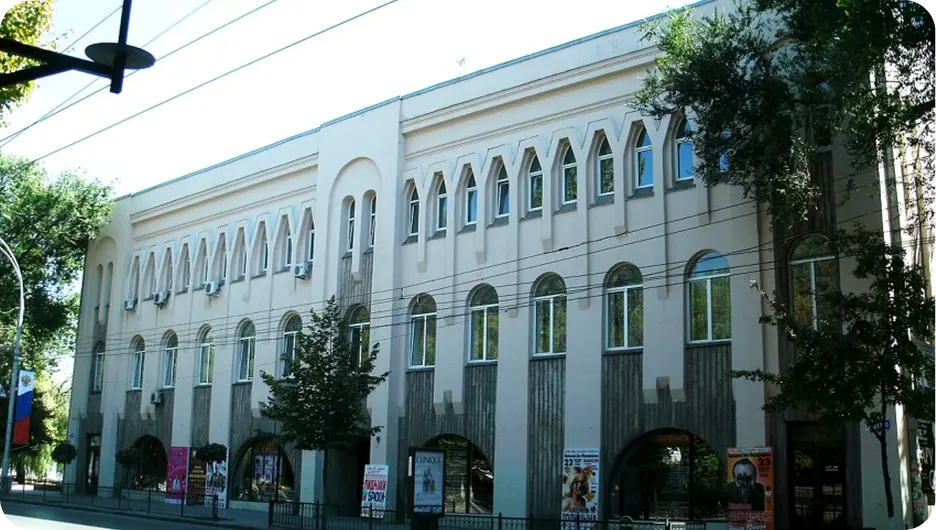
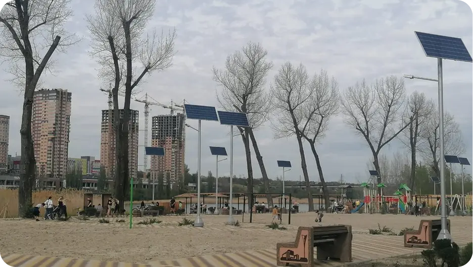

В нашем городе много красивых мест. Вот мои самые любимые:

Красивая набережная: её можно обойти с двух берегов пешком или на авто, а ещё прокатиться на теплоходе с экскурсией.

На Театральной площади — театр Горького и памятник Воинам-освободителям, чуть дальше, на Социалистической улице, — музыкальный театр

Детский парк имени Вити Черевичкина

Филармония — обязательно стоит увидеть, даже если не идёте на концерт

Зелёный остров — хорошее место, когда тепло: там даже можно искупаться в Дону

Также попробуйте местную рыбу и варёных раков в центре — это часть атмосферы города
