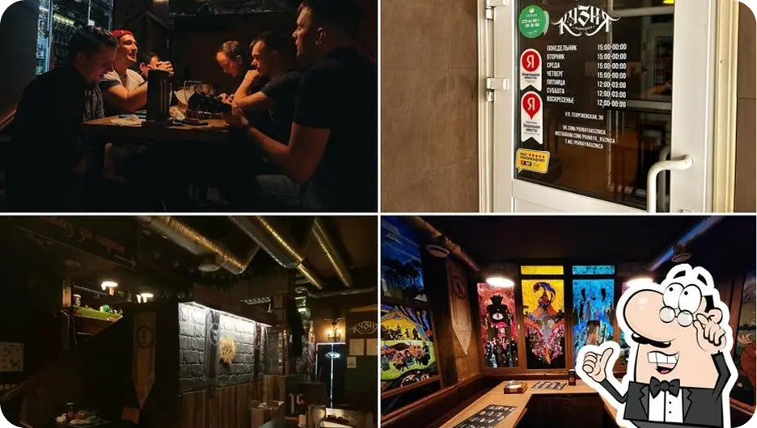
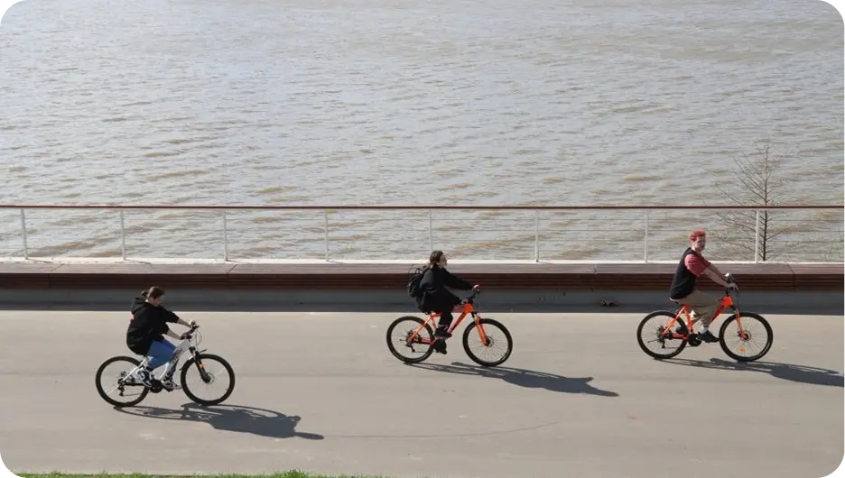
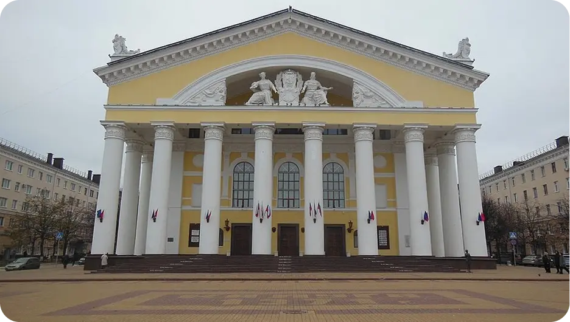
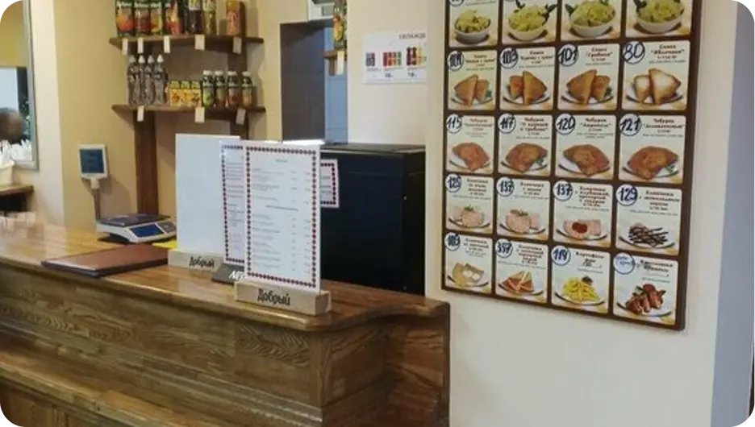

Колыбель космонавтики и спокойная провинция, которая пытается поспеть за Москвой (с переменным успехом).

Советую посмотреть несколько локаций:

Таверна «Кузня» — любимый бар: ламповая атмосфера, классный персонал, вкусные пиво и еда. Любители фэнтези оценят оформление

Погуляйте по набережной водохранилища

Пройдитесь по Театральной площади — это такой локальный Арбат

На углу Театральной и Дзержинского загляните в пончиковую‑чебуречную, а если хочется — заодно зайдите в местный драмтеатр
