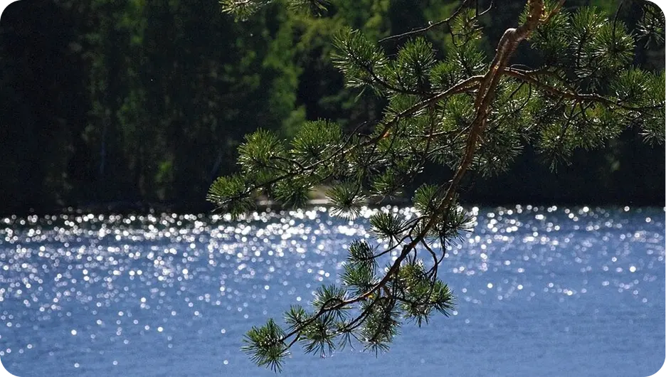
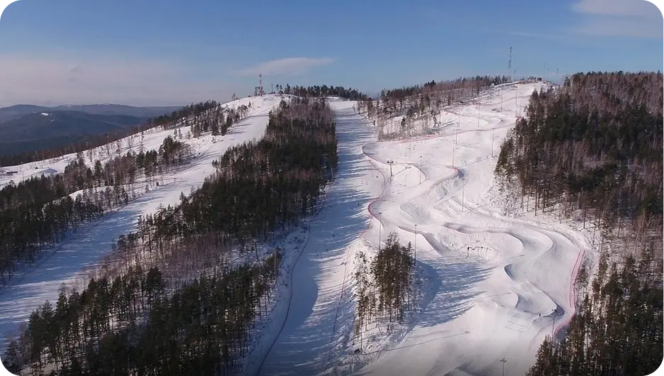
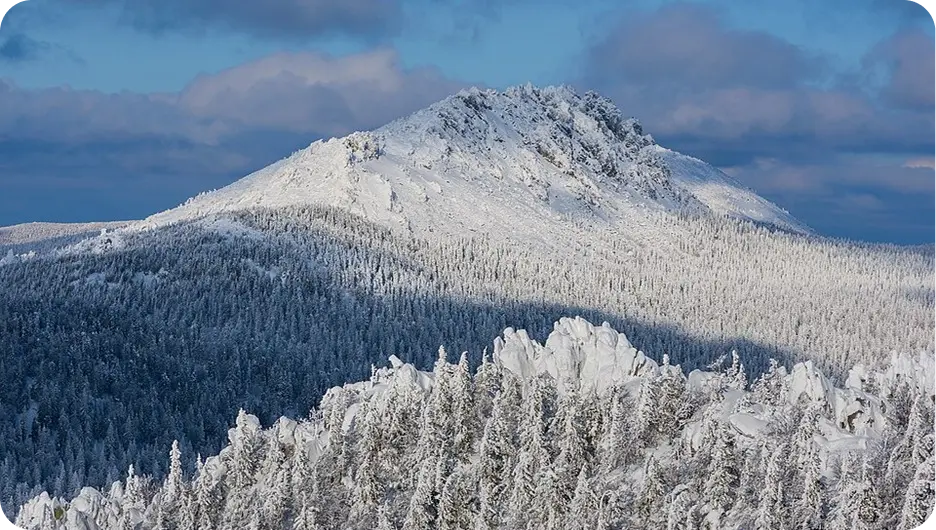

Миасс — город в Челябинской области, расположенный у подножия Ильменских гор на реке Миасс, крупный промышленный и научный центр Южного Урала. Город известен как «город в золотой долине» и является воротами к знаменитым уральским природным достопримечательностям.

Озеро Тургояк — одно из самых чистых и глубоких озёр Урала, которое часто называют «младшим братом Байкала» за прозрачность воды и живописные берега. Оно окружено лесами и горами и является популярным местом отдыха, купания и туризма.

Горнолыжный курорт «Солнечная долина» — современный всесезонный курорт на склонах хребта, предлагающий трассы разной сложности для горнолыжников и сноубордистов. Летом здесь работают канатные дороги, велотрассы и развлекательные программы для туристов.

Национальный парк «Таганай» — одна из главных природных жемчужин Южного Урала с горными хребтами, реликтовыми лесами и знаменитой Двуглавой сопкой. Парк привлекает туристов пешими маршрутами, панорамными видами и уникальной уральской природой.
