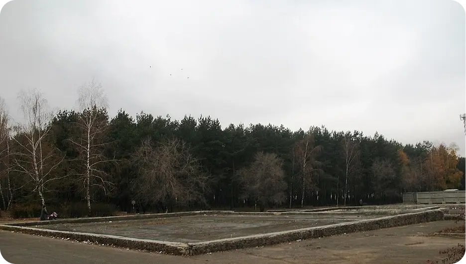
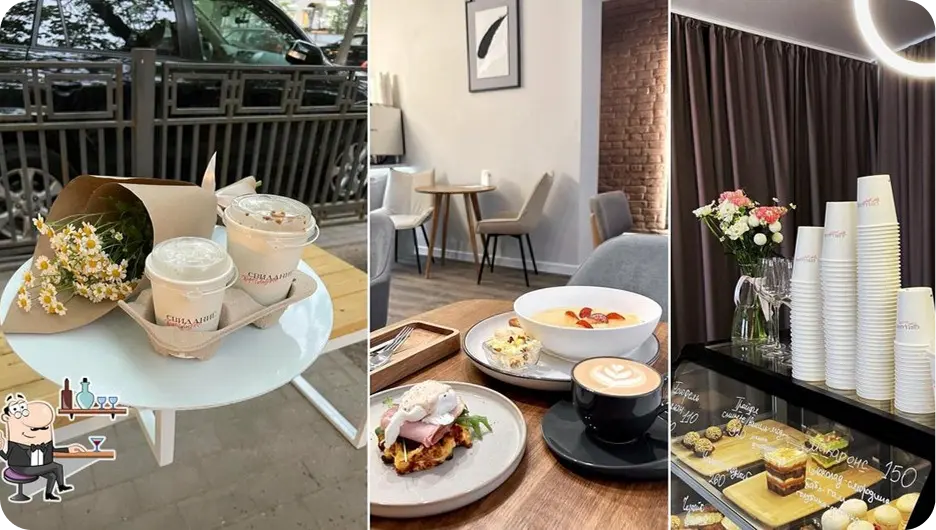
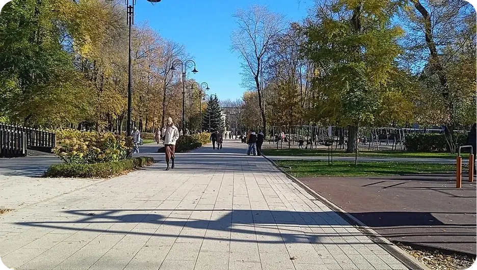

Люблю этот город. Он спокойный и стильный, такая Москва на минималках: есть всё для интересной жизни, но без столичной суеты. Город разделён водохранилищем, а его сердце — оживлённый проспект Революции: тут и уличные музыканты, и стильные заведения, и кофейни на любой вкус.

Парк «Дельфин» — прогулки среди сосен и вид на водохранилище: днём тут шумно и весело, вечером — тихо и атмосферно. За кофе и неспешным отдыхом — в Surf Coffee.

Кофейня «Свидание» на Никитинской — уютные встречи, вкусные вафли и отличный кофе: сюда хочется возвращаться ради атмосферы.

Парк «Орлёнок» — отдельная любовь и идеальное место, чтобы смотреть на закаты: кроны деревьев будто светятся, а фонтан красиво поблёскивает. Отсюда удобно отправиться гулять по городу.
