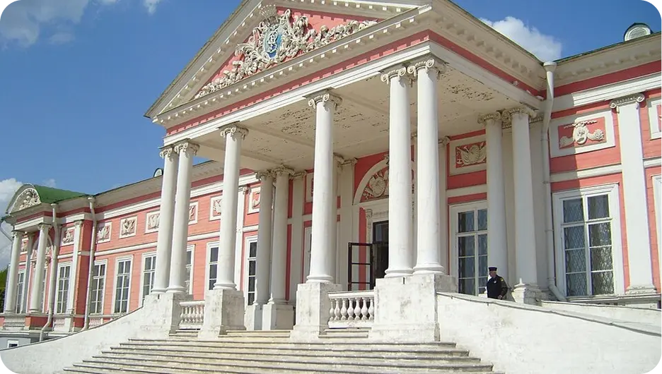
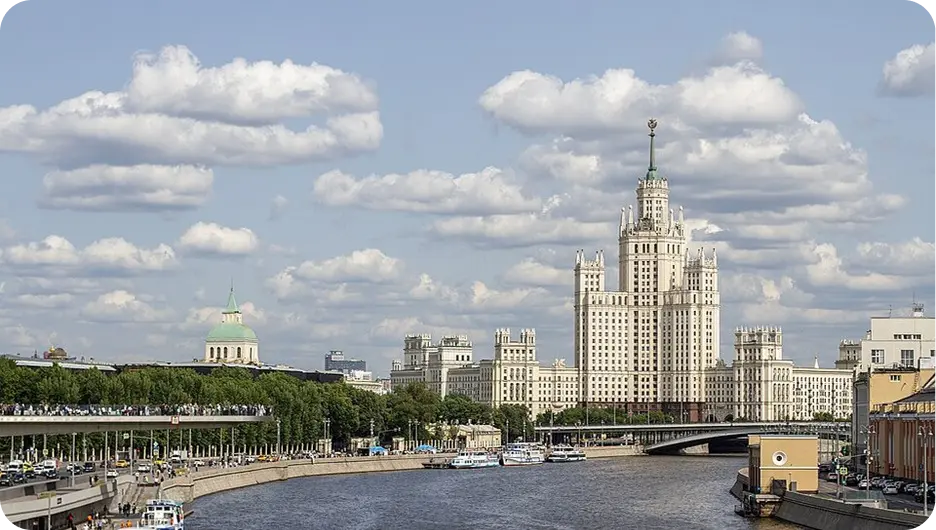
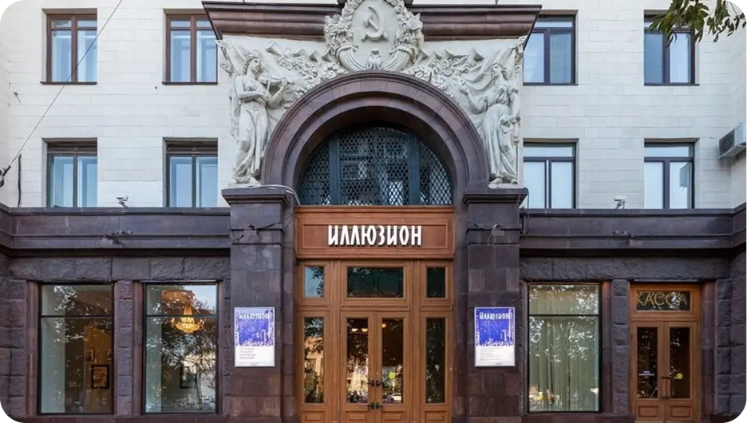

В столице рекомендую обязательно заглянуть в два интересных места:

Кусково — усадьба графа Шереметьева в черте города (МЦД Кусково). Тут приятно погулять среди исторической архитектуры, полюбоваться дворцовым ансамблем, павильонами и ландшафтным дизайном с влиянием европейских традиций. В одном из зданий регулярно проходят органные вечера — отличный повод совместить прогулку с культурным отдыхом. Рядом — лесопарк с прудами: там хорошо гулять, бегать и просто наслаждаться природой.

Кинотеатр «Иллюзион» — легендарный кинотеатр в высотке на Котельнической набережной. Очень красивое и атмосферное место в стиле ампира и ар‑деко. Можно заглянуть во внутренний дворик высотки или в продуктовый магазин с высоченными потолками.
