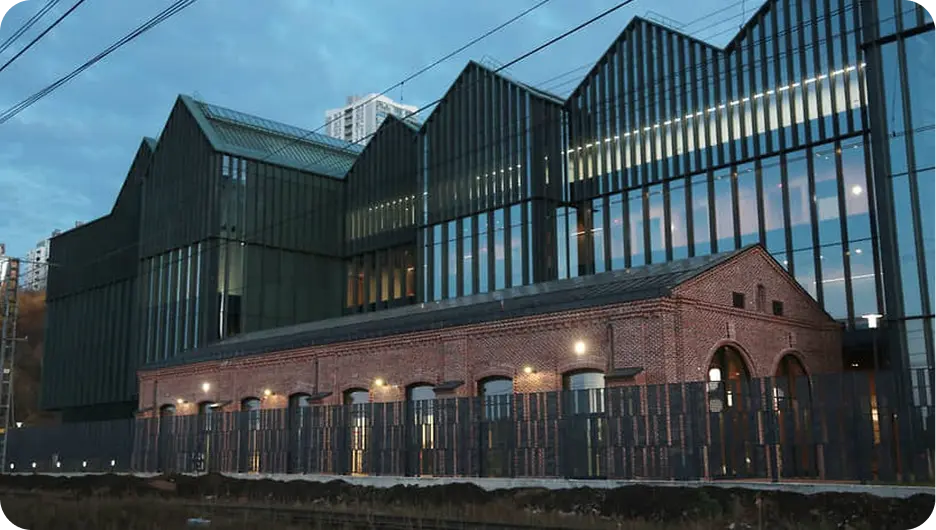
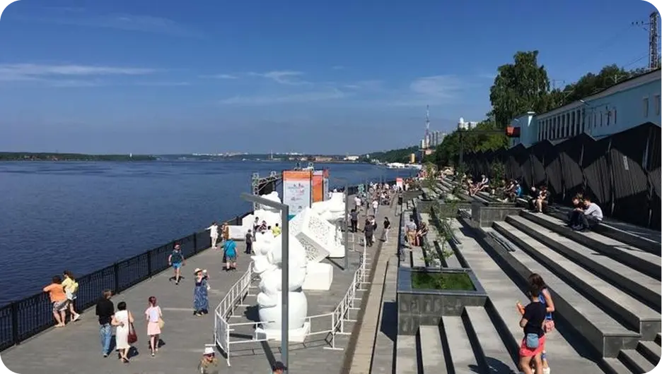
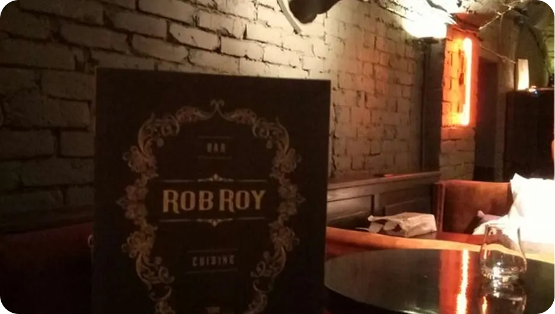
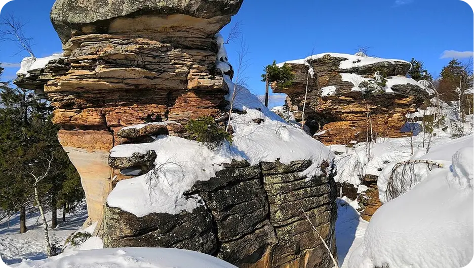

Ухоженный город с уютными улицами, красивой набережной и множеством культурных мест. Стоит заглянуть в новую художественную галерею, на эспланаду, в музей современного искусства и в театр оперы и балета — в нём сохранилась балетная школа ещё со времён эвакуации Мариинки.

Набережная Камы — красивая, тихая, расположена под горой: тут приятно гулять, здесь же проходят разные мероприятия.

Ресторан Rob Roy: можно вкусно поужинать, но столик лучше бронировать заранее.

Пермский край — регион с невероятной природой: в пригороде — Каменный город с живописными скалами, а в 80 км от Перми — Кунгурская ледяная пещера. По рекам Чусовой и Усьве устраивают сплавы — можно поехать с группой или взять индивидуальную экскурсию. Недалеко от города Чердынь на севере края — киноплощадка из фильма «Сердце Пармы»: отличное место для фото.
