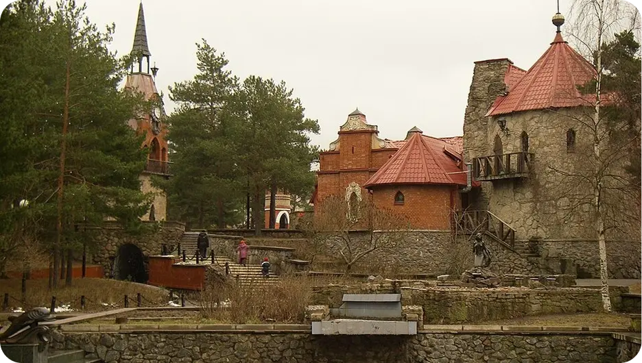
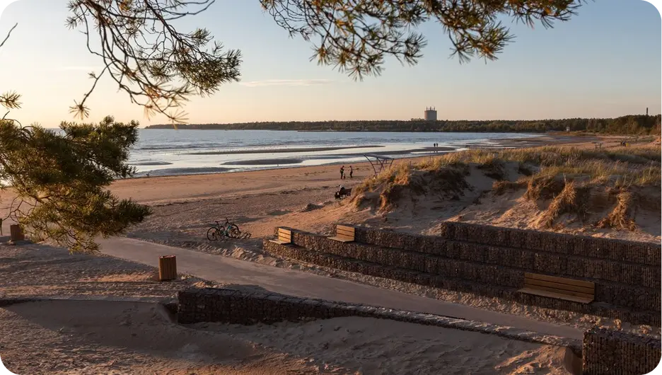
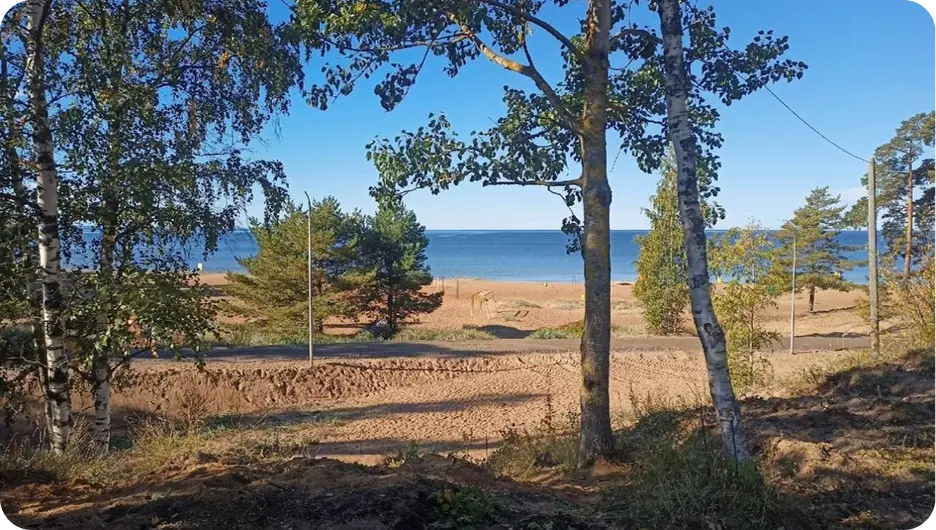

Атомный город на берегу Финского залива, в 1,5 часах езды от Петербурга. Песчаные пляжи, дюны, сосновый лес.

Куда особенно рекомендую заглянуть:

Андерсенград — детский игровой городок в стилистике сказок Андерсена (построен в 1980 году): башенки, бойницы, подземные переходы, мосты, сказочные персонажи. Отличное место для фото.

Приморский Парк — популярное место: большая сцена, территория для прогулок, аренда водного и наземного транспорта, уличные кафе, базы отдыха. Вид на море, велодорожка до ЛАЭС.

Липово — дикий пляж в бухте Финского залива: песок, сосны, километры для прогулок и отдыха.
