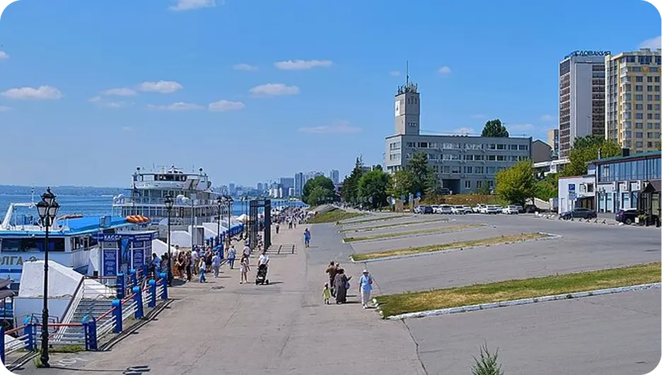
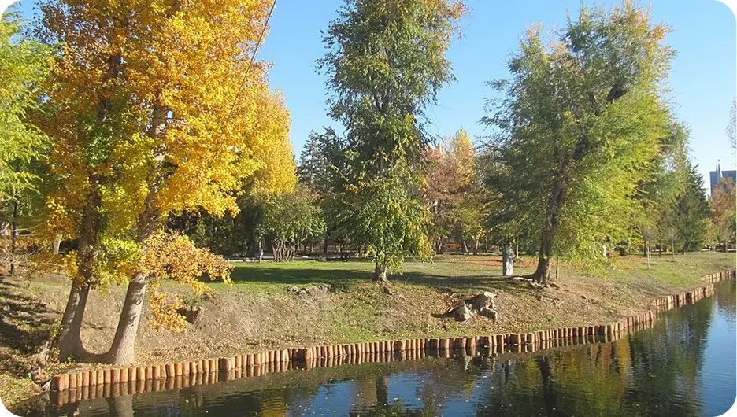
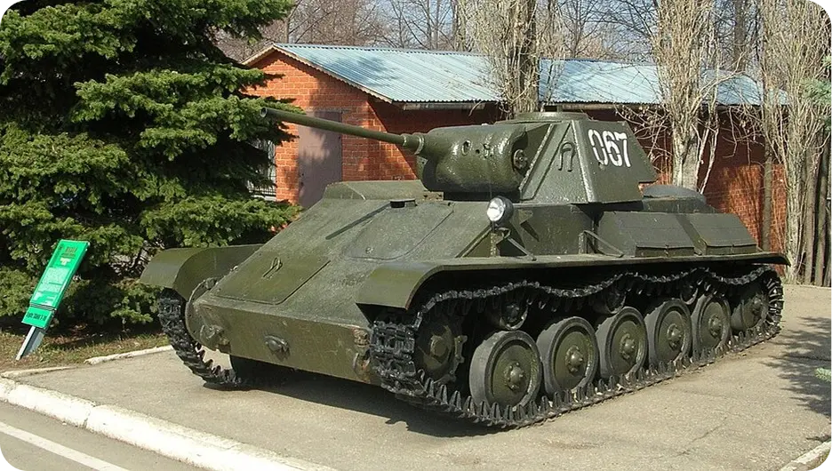

Огромный красивый город, название которого переводится с тюркского как «жёлтая гора» (сары тау). Город построен на перепадах высот — то холмы, то низменности, и с самых высоких точек открываются необыкновенные виды на город и широкое устье Волги.

Одни из самых интересных, на мой взгляд, мест:

Набережная Космонавтов — тихое, уютное место, будто перенесённое из другого города или даже страны: здесь особая атмосфера, и всякий раз, оказываясь тут, легко представить, что уехал куда‑то далеко.

Городской парк имени Горького — место, где можно почувствовать себя словно в настоящем лесу: тут растут дубы старше ста лет, много прудов, в которых плавают утки и лебеди (встречаются даже чёрные), а ещё цветут розовые лотосы. Воздух наполнен запахом дубовых листьев — меня он возвращает к воспоминаниям из детства.

Парк Победы на Соколовой горе — одно из знаковых мест Саратова: отсюда тоже отлично виден город и разлив реки. В парке горит вечный огонь, есть Национальная деревня и большая экспозиция военной техники. Здесь царит особая атмосфера — одновременно гордости, благодарности и тихой печали
