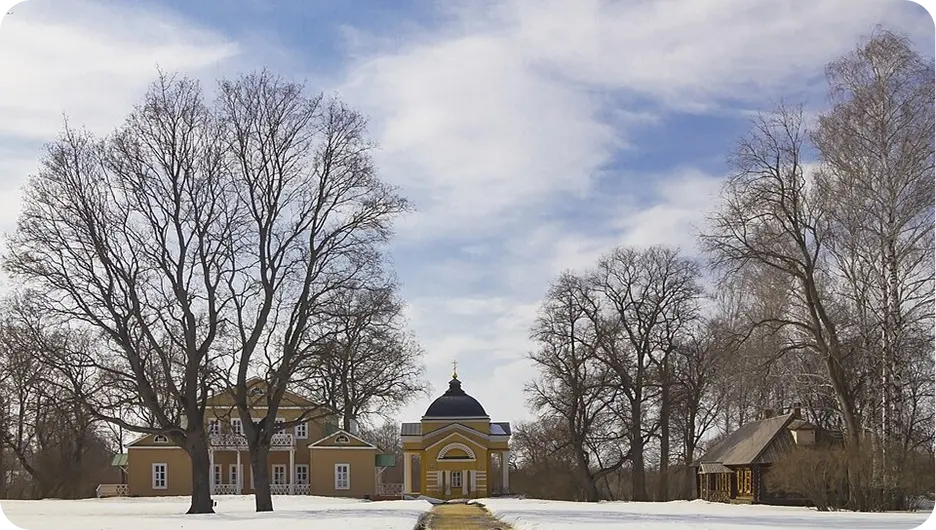
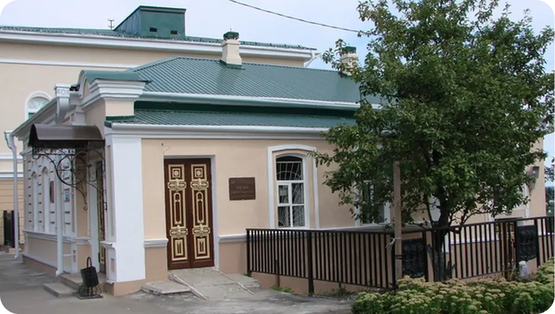
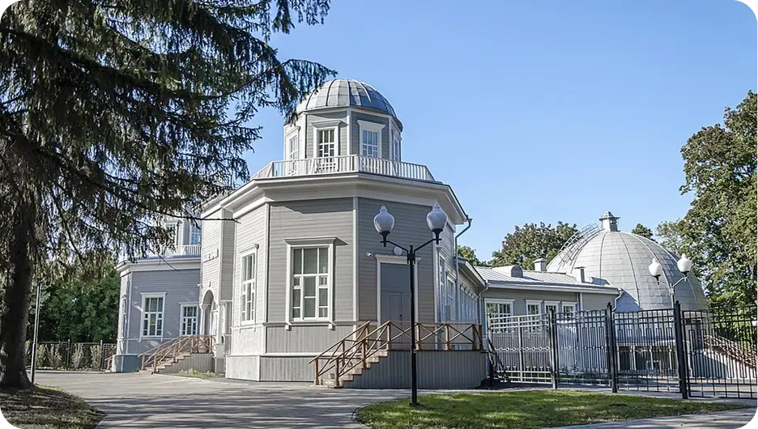
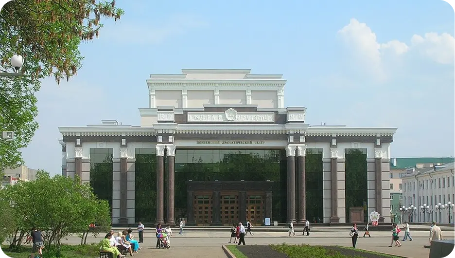
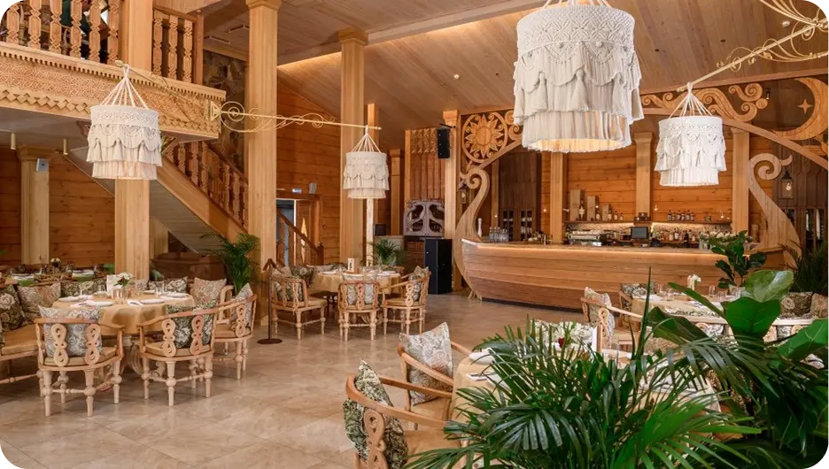
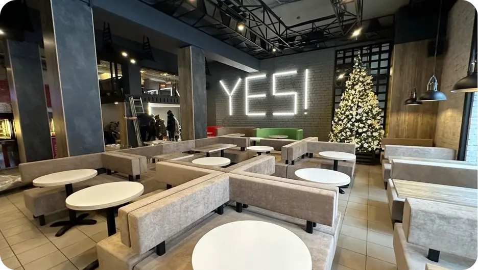

В нашем городе можно и красиво погулять, и культурно обогатиться, и вкусно поесть:

Заповедник «Тарханы» — умиротворяющее место с большой историей

Смотровая площадка у Музея одной картины — отсюда открывается приятный вид на город; рядом — главный собор, а по улице Московской можно спуститься в центр

Планетарий — один из старейших научно-просветительских центров страны и единственное в своём роде деревянное здание планетария с характерными башнями

Пензенский драматический театр — единственный в городе; спектакль «Театр» производит сильное впечатление

Ресторан «Засека» — историческое заведение, работает с 1978 года

Пиццерия YESпицца — легендарный вкус, знакомый многим с детства
