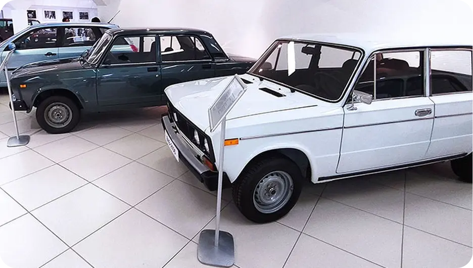
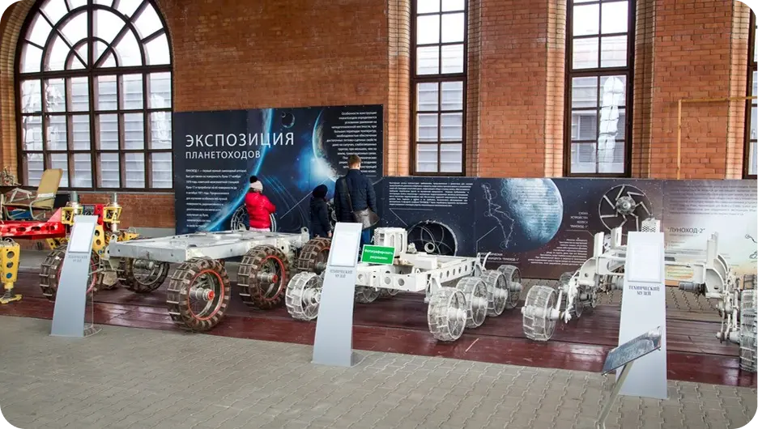
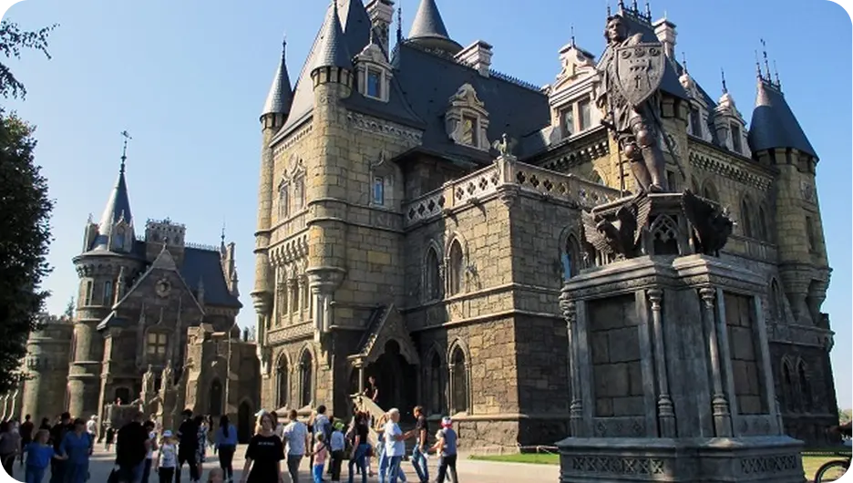
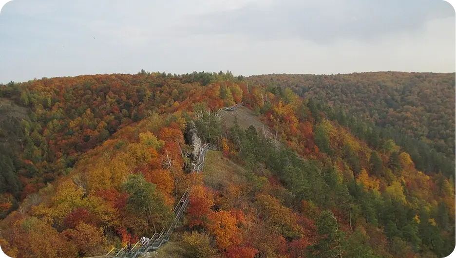
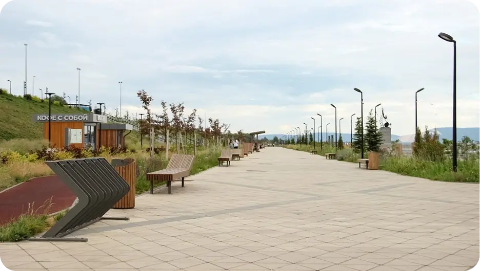
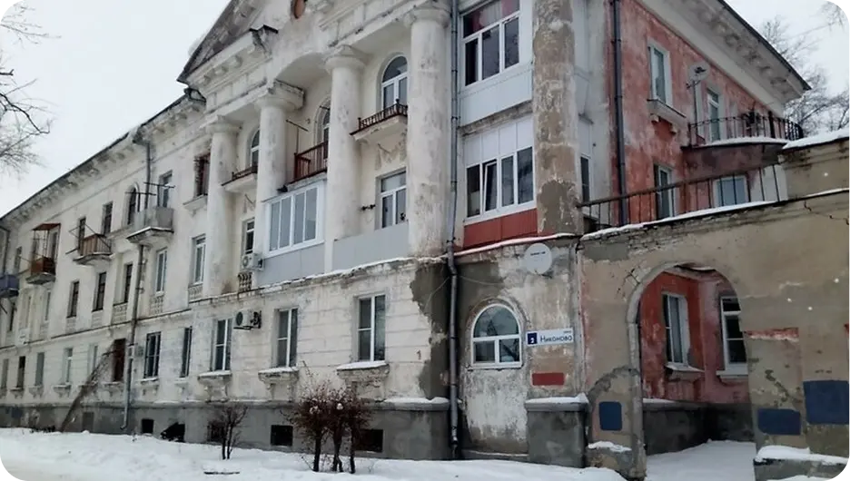
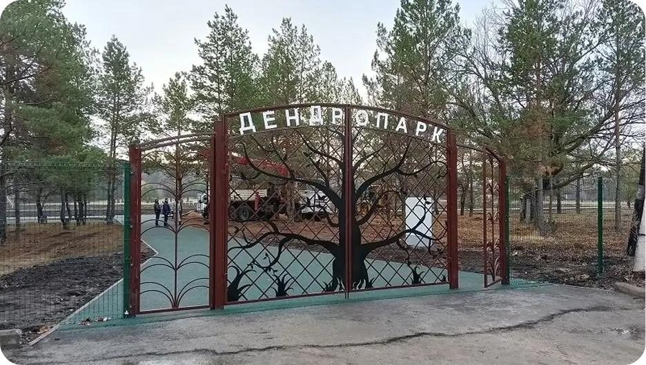
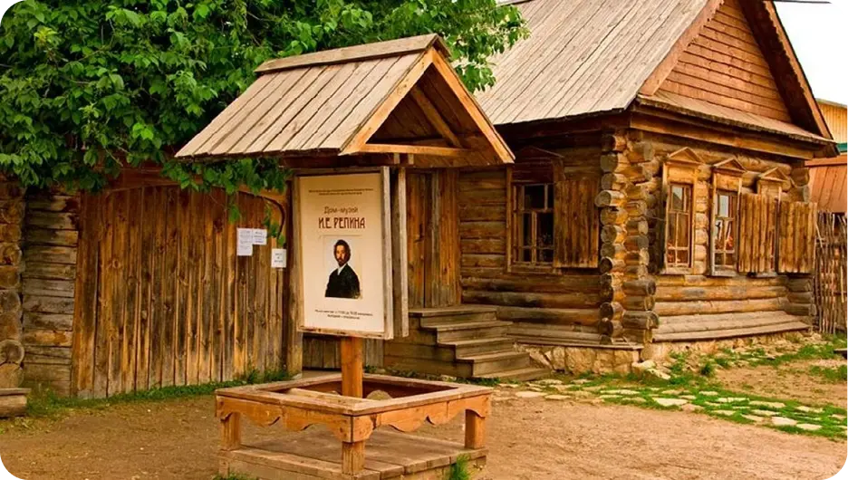
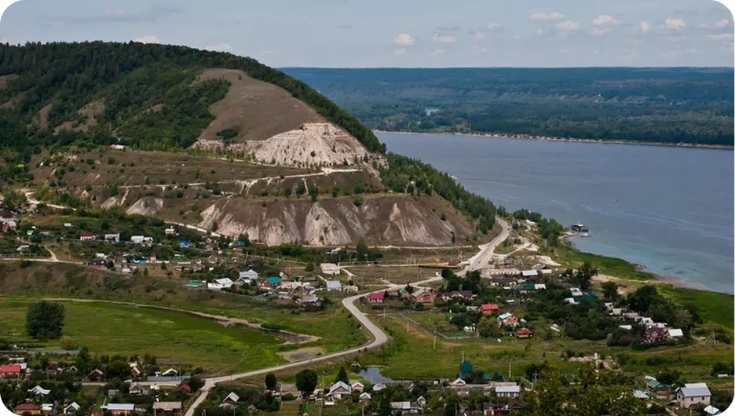
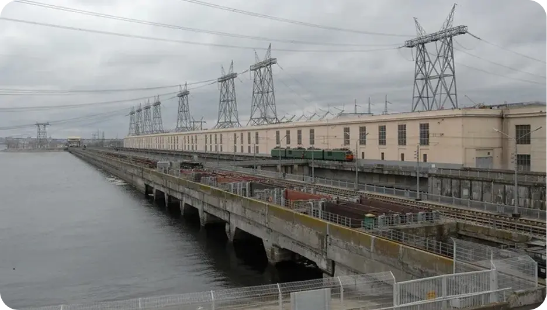

В Тольятти много интересных и иногда неожиданных мест, которые рекомендую посетить:

Музей «АвтоВАЗа» — наглядно показывает историю создания крупнейшего автогиганта страны (с 1966 года): от советской классики до современных моделей. В коллекции — свыше 80 автомобилей, в том числе уникальные экспериментальные разработки, спортивные и рекордные машины, которые не пошли в серию

Парковый комплекс истории техники имени К.Г. Сахарова — большая экспозиция техники, по которой видно, как развивалась инженерная мысль

Памятник В.Н. Татищеву — стоит на берегу Волги, от него открывается красивый вид на водохранилище

Спасо‑Преображенский собор — заметный храм, выглядит внушительно, внутри богатое убранство

Замок Гарибальди — постройка в эклектичном неоготическом стиле, сочетает элементы европейского романтизма и викторианской эпохи. Главная деталь — 60‑метровая башня‑донжон, она же обзорная площадка с видом на реку

Жигулёвские горы и гора Стрельная — единственные горы тектонического происхождения на Русской равнине; тут растут редкие растения‑эндемики, которых больше нигде нет

Тольяттинские набережные — удобные променады вдоль Волги, приятно гулять и смотреть на воду

Ансамбль исторической застройки посёлка Шлюзовой — типичный советский классицизм, у района свой узнаваемый облик

Дендропарк — зелёная территория, где можно спокойно пройтись и посмотреть на разные деревья

Музей Репина в селе Ширяево — место, где художник делал эскизы к «Бурлакам на Волге»; можно увидеть наброски и почувствовать ту самую атмосферу

Национальный парк «Самарская Лука» — живописная излучина Волги, есть тропы, с которых открываются хорошие виды

Жигулёвская ГЭС — крупный инженерный объект, впечатляет масштабом, понятно, какую роль он играет в энергосистеме
