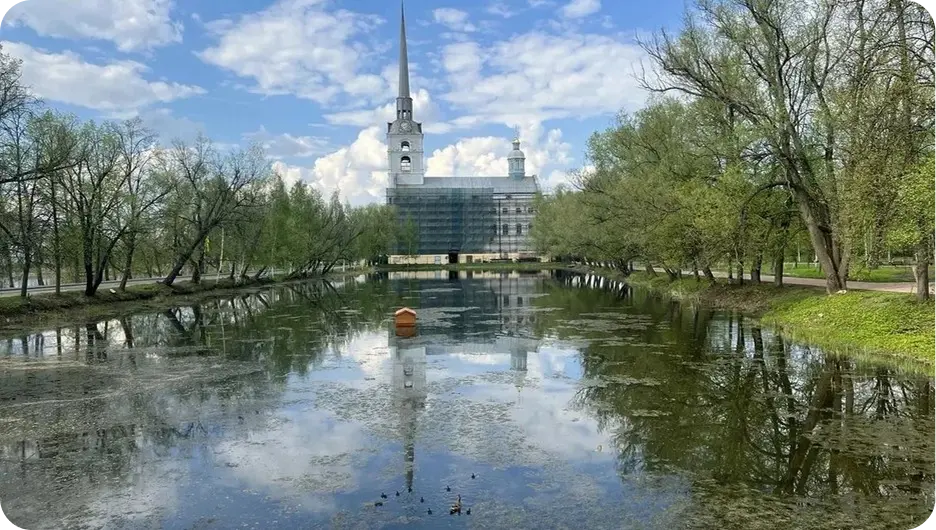
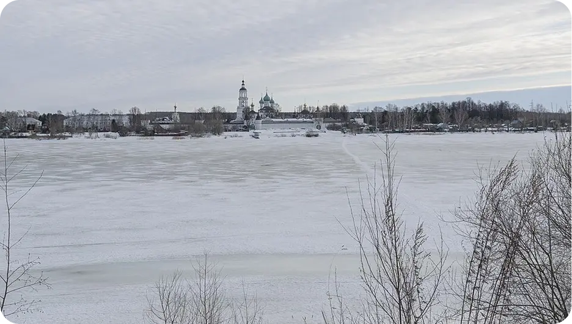
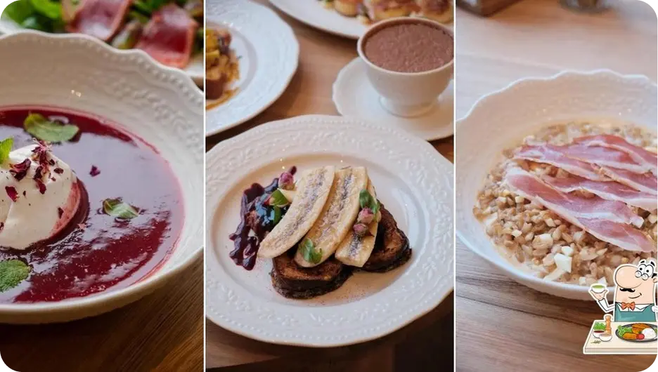
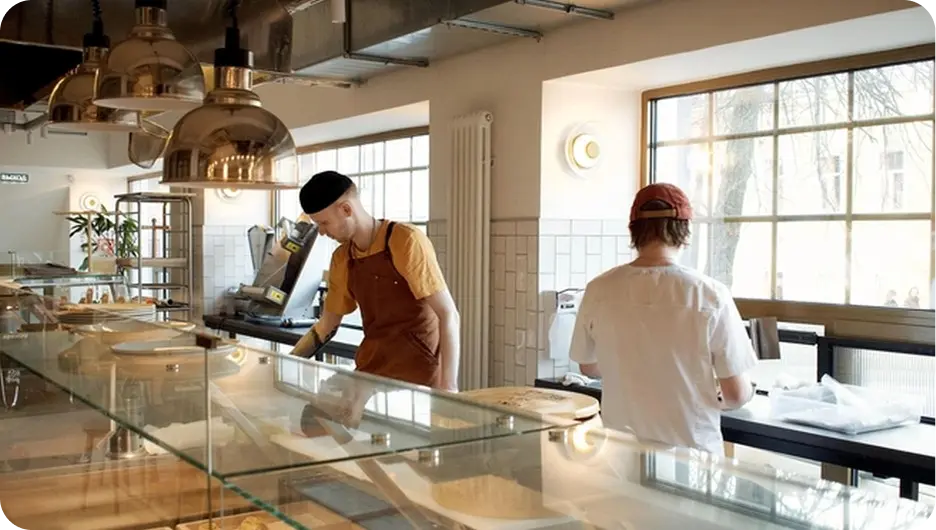
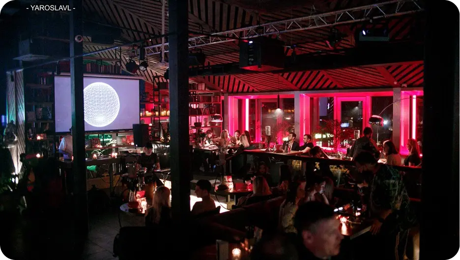
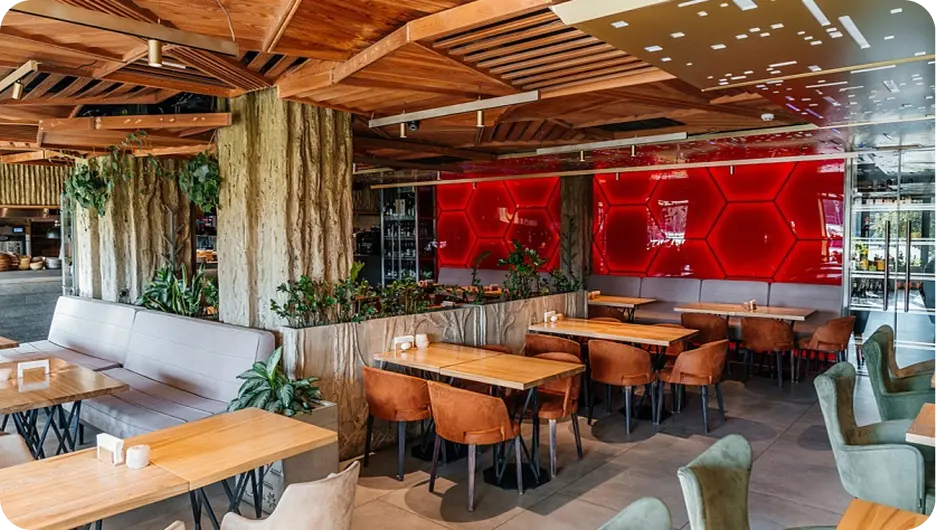

Ярославль заметно похорошел за последние годы: летом тут много цветов — клумбы, кашпо и прочее. Центральные улицы сделали пешеходными — по ним приятно гулять, а ещё в городе появилось множество крутых заведений, где можно вкусно и красиво поесть.

Мой личный топ:

Петропавловский парк — для меня он особенный. Раньше это было тёмное, мрачное место без единого фонаря, а теперь его благоустроили, и стало ещё прекраснее, хоть и по‑другому. Парк совсем не в центре, поэтому тут мало людей и всегда тихо.

Толгский монастырь (Толга) — невероятно красивое место. Даже если не заходить в храм (хотя он достоин внимания), сама территория точно не оставит равнодушным. Лучше всего добираться туда на речном трамвайчике по Волге — масса впечатлений всего за 100 рублей.

Где поесть:

«Марфа едет в город» — вкусно, красиво, очень приятный персонал.

«Люди на кухне» — интересное меню, своя мясная гастрономия, регулярно проводят акции: то безлимитный рислинг, то что‑нибудь ещё.

Good Karma — кальяны и отличная коктейльная карта.

«Сказка. Еда и вино» — здесь лучший борщ в городе, хороший выбор вина, а для непьющих путешественников есть локальный тоник.

Могу ещё много рассказать. Будете у нас в гостях, пишите — всё покажу!
