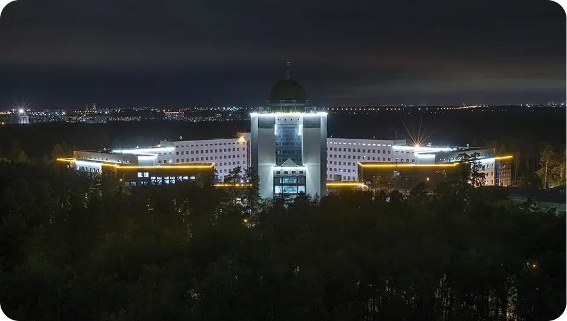
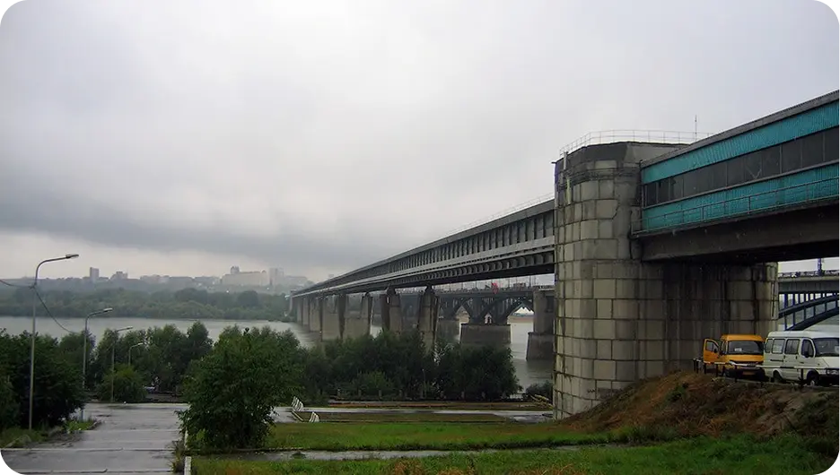
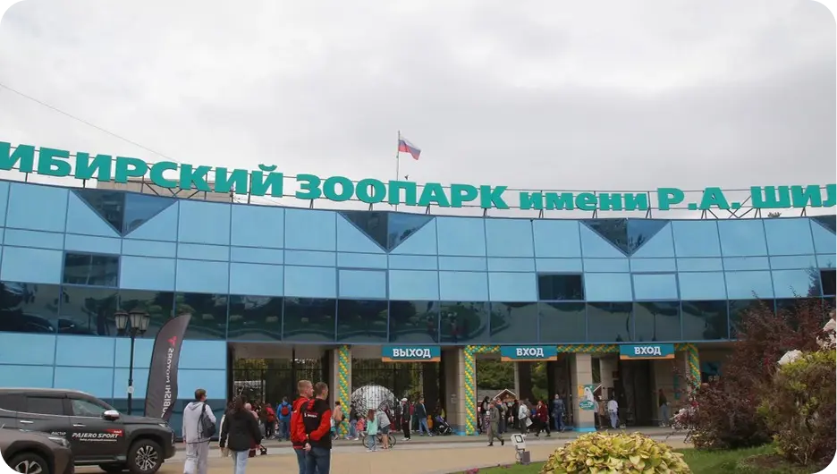
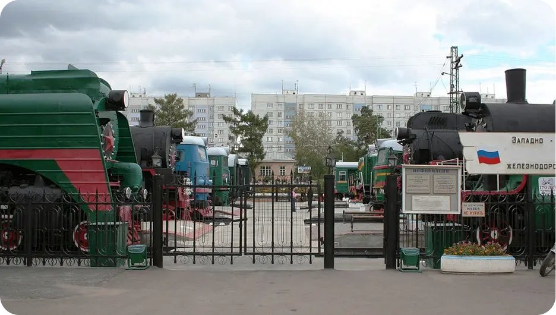

Тот самый город серых домов, столица Сибири и любовь навсегда! Здесь советский конструктивизм и монументальные проспекты (Красный проспект — самая длинная улица в мире) соседствуют с уютными парками, а рядом кипит жизнь одного из главных научных, деловых и студенческих центров России.

Моя любимая локация и главное место силы — Академгородок. В последние годы его всё чаще называют «Сибирской Кремниевой долиной»: многие едут учиться в НГУ, устраиваются в ИТ‑проекты и остаются жить в Новосибирске навсегда.

Главные точки притяжения в Академгородке:

Spot&Choo„s (ул. Ильича, 10) — самые вкусные бургеры и уникальная атмосфера Академгородка. Вам здесь понравится настолько, что вечером захочется вернуться за бутылочкой пива с луковыми кольцами.

Команда Aktruefireworks — легендарные вечеринки: от кинопоказов на улице до масштабных рейвов. Организаторы арендуют заброшенные пространства — недействующие бассейны, речные причалы, старые аэропорты — и собирают там до тысячи человек. Ивенты проходят в тёплое время года, точное место сообщают в каналах за день до события. Вход — около 500 рублей.

Обское море (водохранилище). Огромный искусственный водоём, местные пляжи называют «Сибирской Ривьерой» — тут проходят классные пляжные вечеринки. Вбейте в карты «Центральный пляж Академгородка»: примерно 10 минут пешком от центра.

Что ещё посмотреть в Новосибирске:

Метромост — самый длинный крытый метромост в мире (2145 метров). Соединяет левый и правый берега Оби между станциями «Студенческая» и «Речной вокзал». Спускаемся в метро, покупаем жетон за 48 рублей, едем по красной ветке и наслаждаемся видами.

Зоопарк имени Р.А. Шило (ул. Тимирязева, 71) — один из крупнейших в России. На лесопарковой территории в комфортных условиях живут тысячи животных, включая легендарного лигра. Летом приятно часами рассматривать обитателей, зимой — наблюдать за снежными барсами и амурскими тиграми на фоне заснеженной тайги.

Музей железнодорожной техники (ул. Разъездная, д.. 54/1). Здесь можно пройтись вдоль настоящих паровозов и вагонов разных эпох — многие разрешено изучать изнутри.
