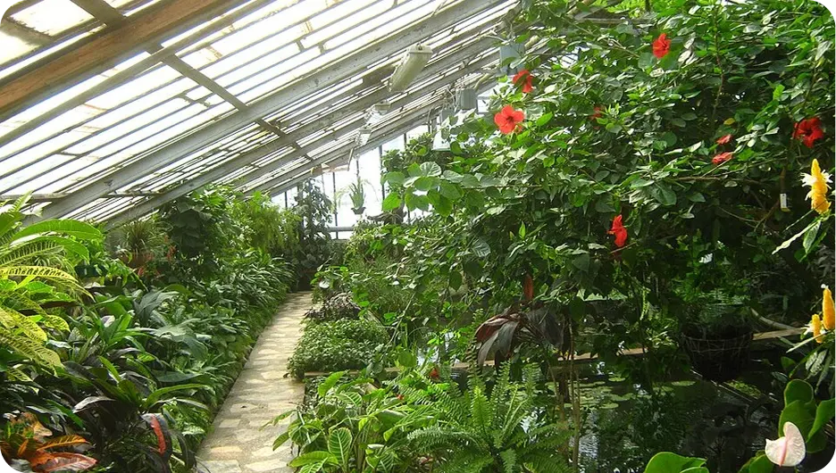
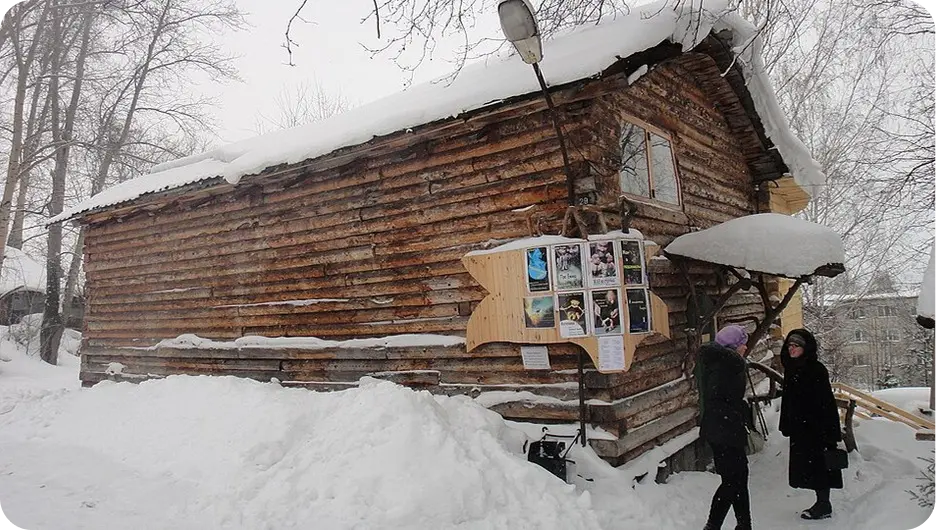
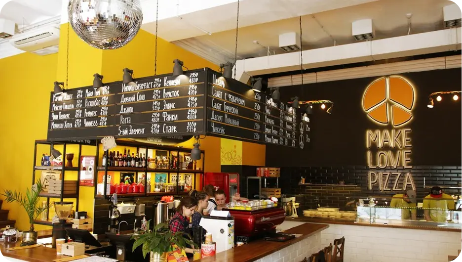

Город, в котором точно стоит побывать хотя бы раз! Здесь сохранились целые улицы старинных деревянных домов с удивительной резьбой, а рядом с ними кипит жизнь одного из главных научных и студенческих центров России. Именно здесь открылся первый университет за Уралом, благодаря которому Томск получил прозвище «Сибирские Афины». Можно прогуляться по уютным историческим улочкам, увидеть необычные памятники и почувствовать особую атмосферу молодого города с более чем 400‑летней историей. А ещё здесь есть офис VK!

Сибирский ботанический сад ТГУ — огромные оранжереи с тропическими растениями, высокими пальмами и настоящими фруктами, которые растут прямо на деревьях. Особенно необычно оказаться в тропиках, когда на улице сибирская зима.

Театр живых кукол «2+Ку» — небольшой и очень необычный авторский театр, где представления проходят с участием уникальных механических кукол. Здесь своя сказочная атмосфера, а спектакли интересны не только детям, но и взрослым.

Make Love Pizza — томская пиццерия с необычным оформлением, яркой атмосферой и собственным характером. Это не просто место, где можно поесть пиццу, а один из узнаваемых локальных проектов, который вырос за пределы Томска.
