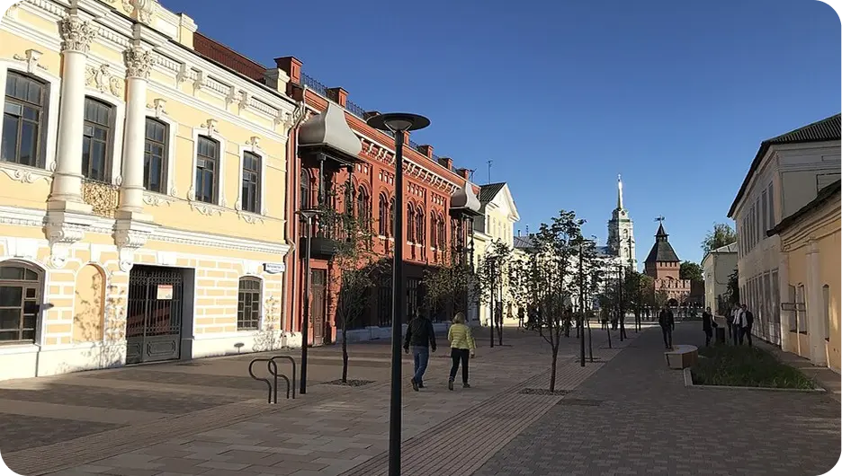
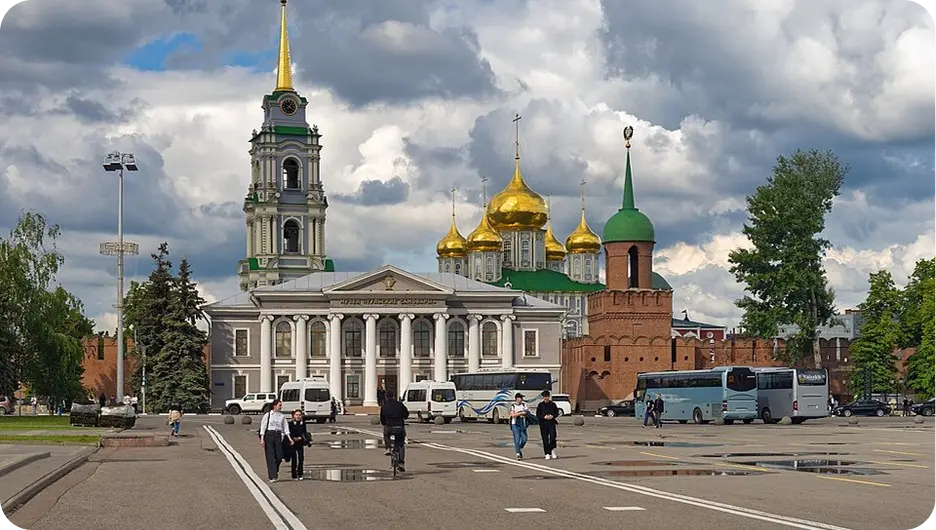
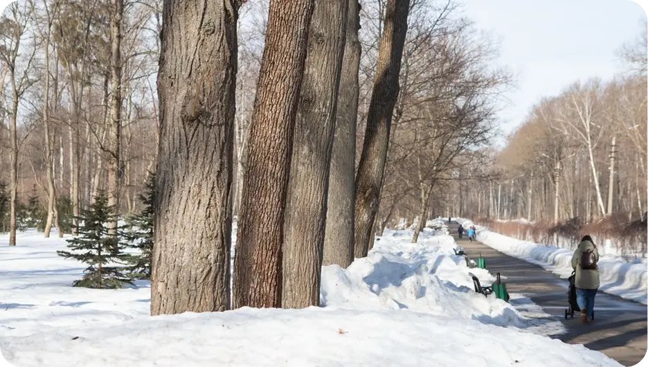
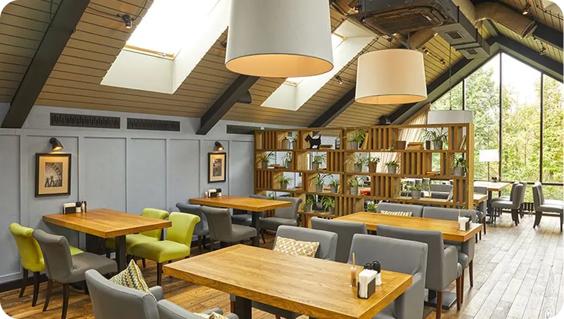

Тула — не только про самовары и пряники. Хотя и про них тоже:) Что советую посмотреть:

Пространство «Искра» и улица Металлистов — самое оживлённое место города. Тут можно погулять по красивой набережной и найти заведение себе по вкусу: пивные рестораны, бургерные, места с морепродуктами, ларьки с пряниками и пирожками — найдётся всё

Кремль — тут можно забраться на стены крепости (за денежку, но недорого), попасть на мастер‑класс по созданию пряников и в целом накупить много пряников: Тула — пряничная столица

Белоусовский парк — в городе хватает крупных парков, но этот самый разносторонний. Можно сходить на пляж, покататься на лошадях (опять же за денежку), посетить животный уголок, покататься на аттракционах, взять напрокат ролики или другое катающееся средство. Ещё тут строят большой аквапарк

А ещё можно посидеть в «ПетрПетровиче» — хороший пивной ресторан
