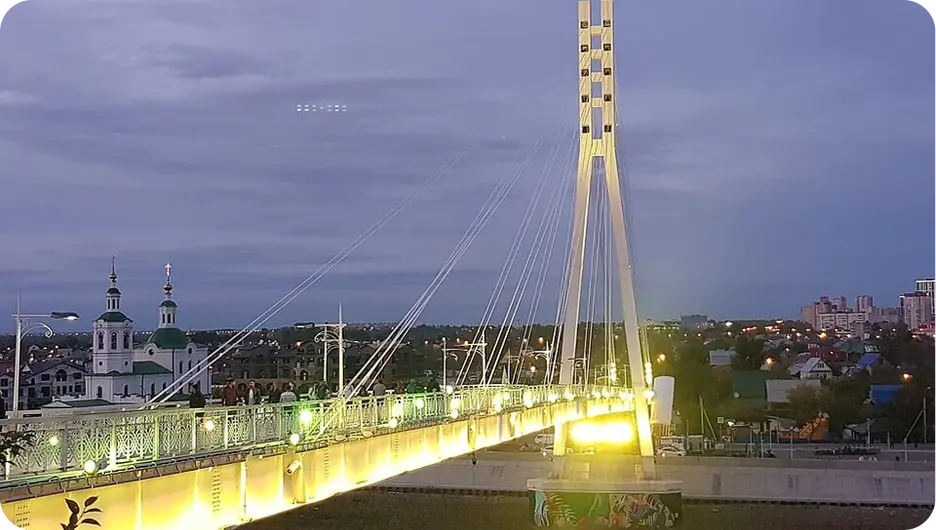
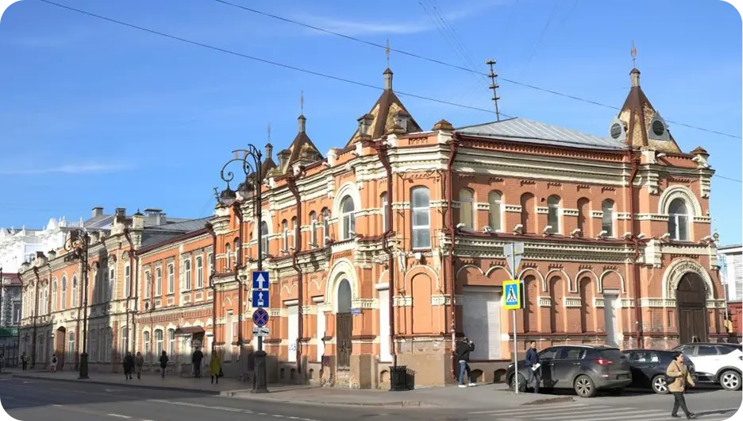
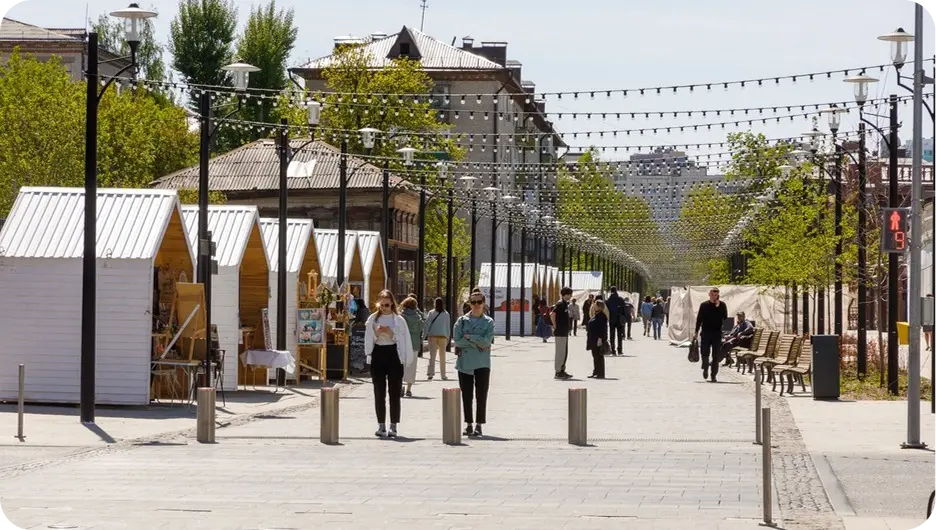
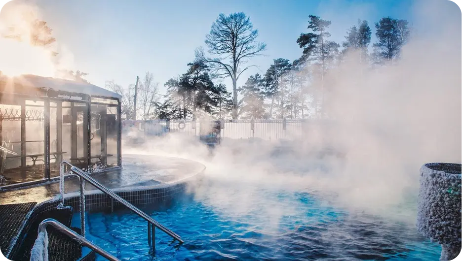
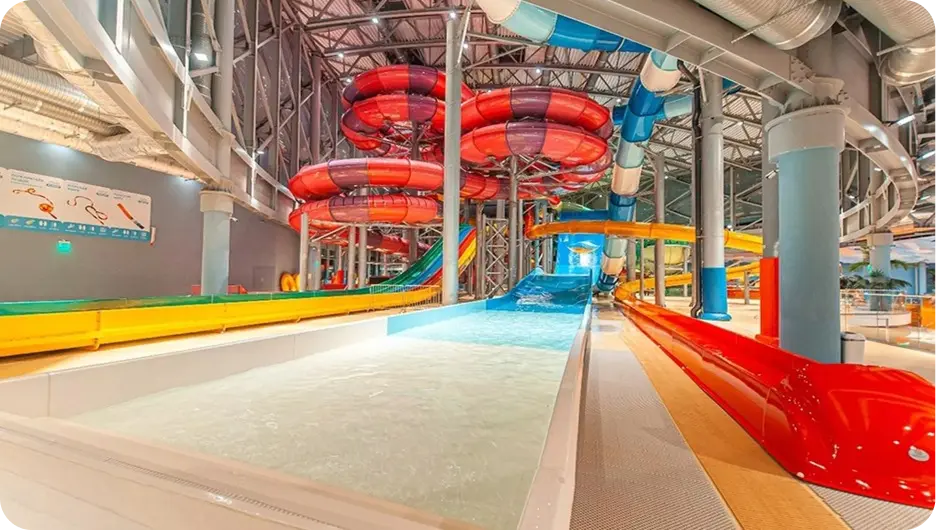

Лучший город Земли — согласно независимому мнению его жителей и растяжке в центре города.

Тюмень — сердечко Сибири. Компактный, красивый, старинный город, который восстал из грязи и пепла благодаря Собянину. Если вы видите, как похорошела сегодня Москва, — это Сергей Семёнович на Тюмени успешно потренировался.

Что посмотреть:

Начните с набережной реки Туры — оттуда открывается красивый вид на подсвеченный Мост влюблённых

Потом прогуляйтесь по улице Республики в сторону улицы Мельникайте, любуясь старинной архитектурой

Дойдите до пешеходной улицы Дзержинского и загляните в местные бары и рестораны. Если любите джаз — посетите «Майлз». Для летних вечеринок под открытым небом подойдут «Контора пароходства» и «Двор, как мы любим».

Вишенка на торте — горячие источники. Особенно впечатляюще они выглядят зимой: восхитительно плавать в горячей воде и любоваться хвойным лесом. Рекомендую «Тайгу» или «Верхний Бор».

Также можно посетить «ЛетоЛето» — огромный аквапарк, где есть и уличные термальные источники.
