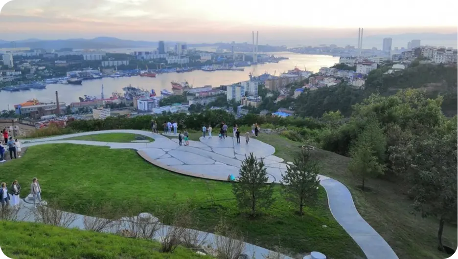
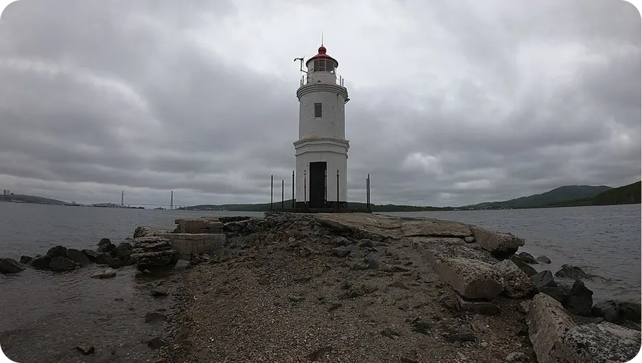

Владивосток — мой родной город, который я очень люблю. Он совершенно особенный: здесь море, сопки, невероятные пейзажи и ощущение близости Азии. На мой взгляд, лучшее время для поездки — август и сентябрь, когда можно насладиться тёплым морем, красивой природой и долгими прогулками.

Вот несколько мест, которые я особенно люблю:

Парк Нагорный — одно из моих любимых мест с видом на весь город. Отсюда особенно красиво наблюдать за Владивостоком, его бухтами и мостами, особенно на закате.

Русский остров и мосты Владивостока — места, которые невозможно не полюбить. Здесь невероятная природа, живописные бухты и ощущение свободы. А знаменитые мосты — настоящая гордость города.

Токаревский маяк — одно из самых атмосферных мест Владивостока. Люблю его за шум моря, красивые виды и ощущение, будто находишься на самом краю земли.

И не забыть прогуляться по набережной и заглянуть в Супру за хинкали с креветкой! Если хочется увезти с собой частичку Владивостока, обязательно загляните в «Приморский кондитер». Здесь можно купить легендарные конфеты «Птичье молоко» и шоколад с морской солью. Благодаря близости Азии во Владивостоке также большой выбор японских сладостей и товаров, которые станут необычными сувенирами.
