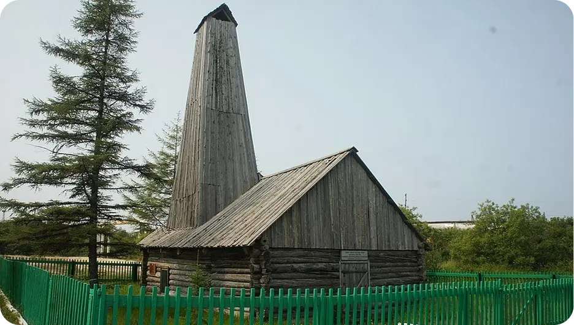
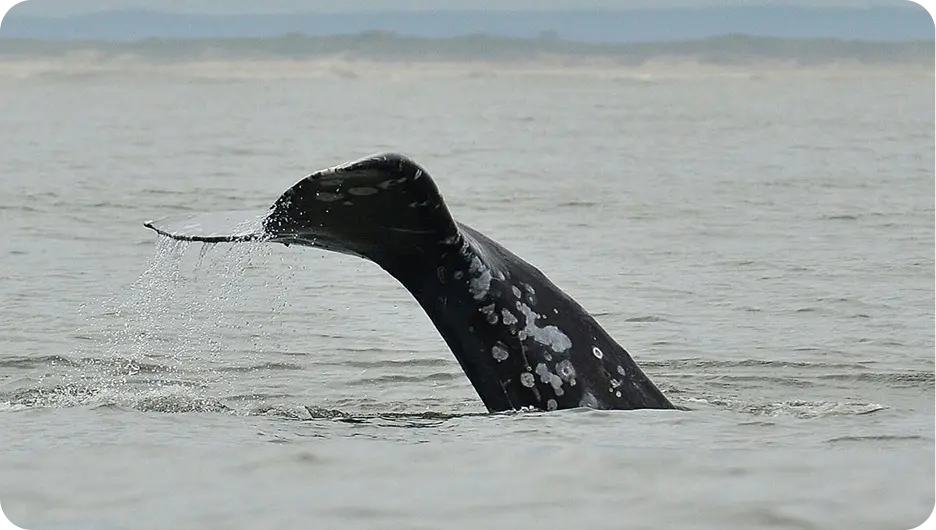
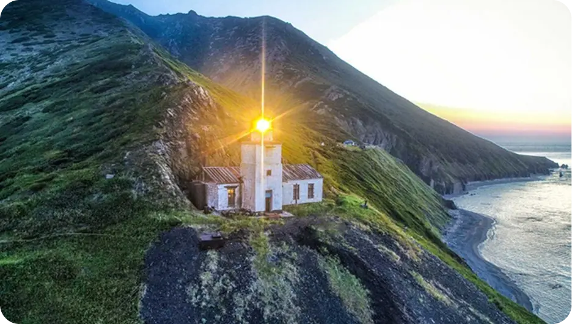

Я родилась в Охе — городе на самом севере острова Сахалин, который с трёх сторон омывают холодные моря. Этот город называют нефтяным сердцем Дальнего Востока, так как здесь добывают просто колоссальные объёмы нефти.

Прежде всего я люблю Оху за суровый климат со снежными метелями по самую крышу, невероятно красивую дикую природу, чистейшие реки и, конечно же, за дыхание бескрайних морей, которое чувствуется в любой точке города. Это суровый край, но живут здесь очень добрые и отзывчивые люди.

В Охе обязательно стоит увидеть:

Уникальную Вышку Зотова 1910 года — это единственный символ зарождения нефтяной промышленности России, который дошёл до нас в первозданном виде.

Летом можно посетить залив Пильтун, чтобы увидеть редчайших серых китов, которые подходят прямо к берегу.

Полуостров Шмидта — если хотите ощутить всю красоту и мощь северной природы, есть — край земли, где встречаются Охотское море и Татарский пролив.
