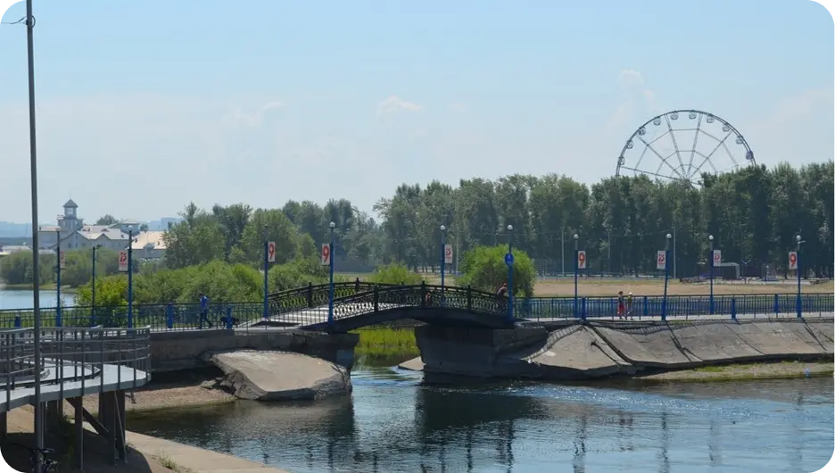
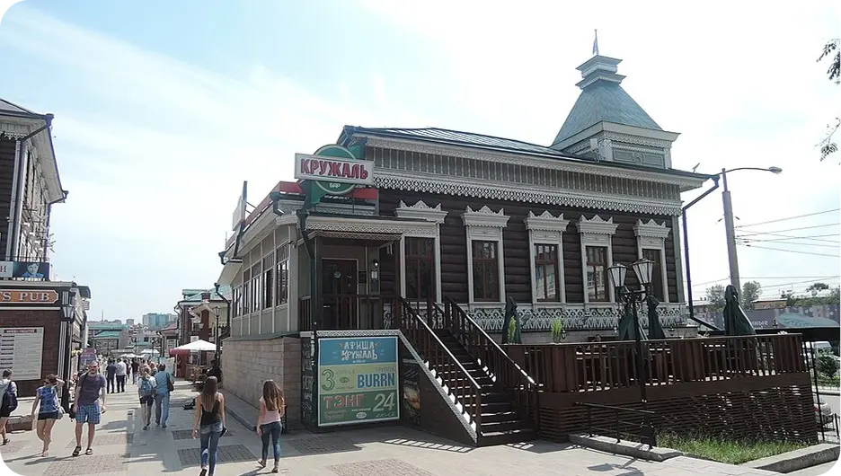
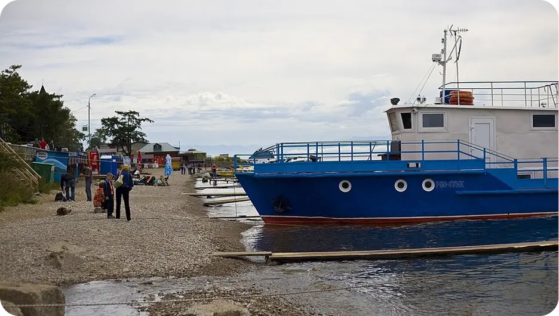

Я живу в Иркутске и особенно люблю этот город за то, что именно здесь встретила свою любовь. Несмотря на сибирские морозы, лето у нас бывает жарким. В такие дни особенно приятно гулять по набережной Ангары и острову Юность. Иркутск вообще хорош тем, что здесь можно наслаждаться красивой природой, старинной архитектурой и неспешными прогулками.

Вот несколько мест, которые советую посетить:

Остров Юность — отличное место для прогулки в центре города. Здесь можно прокатиться на колесе обозрения и посмотреть на Иркутск и Ангару с высоты, погулять по парку или попробовать разные аттракционы.

130-й квартал — пешеходная зона со старинными деревянными домами, сувенирными лавками и небольшими палатками. Здесь можно найти местные сувениры и варенье из шишек, которое очень советую попробовать. А ещё здесь находится знаменитый Бабр — символ Иркутска с городского герба.

Листвянка и Байкал — пожалуй, главное место, ради которого стоит приехать в Иркутск. Байкал прекрасен в любое время года: летом здесь можно любоваться озером и пробовать омуля, а зимой, когда встаёт лёд, — кататься на коньках. Если любите активный отдых и уверены в своих силах, советую пройти часть Большой Байкальской тропы.

В самом Иркутске тоже много интересного: красивые парки, достопримечательности и старинные деревянные дома с резными украшениями. Но если окажетесь в наших краях, обязательно выделите время для поездки на Байкал — его стоит увидеть хотя бы раз.
