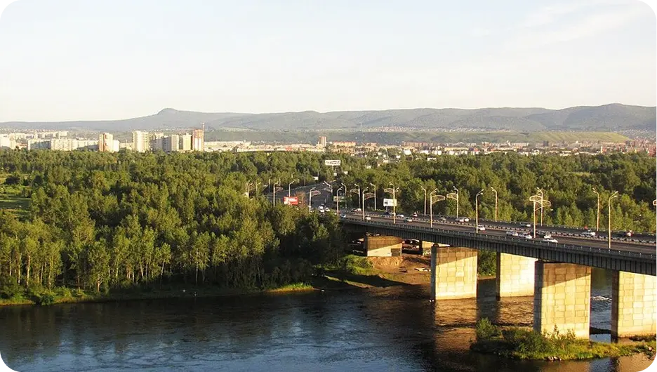
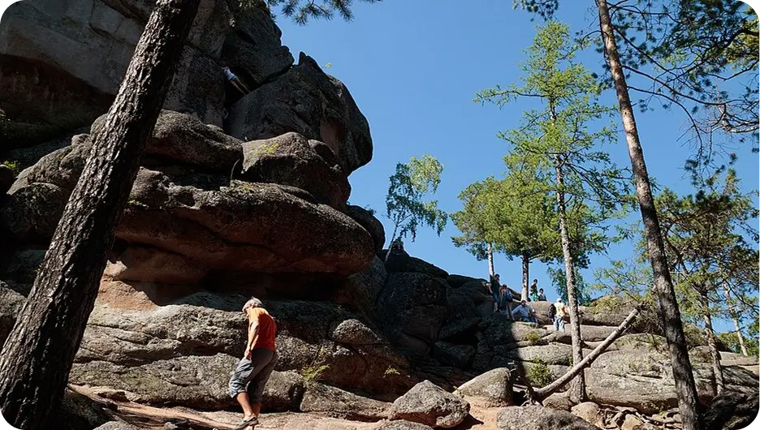
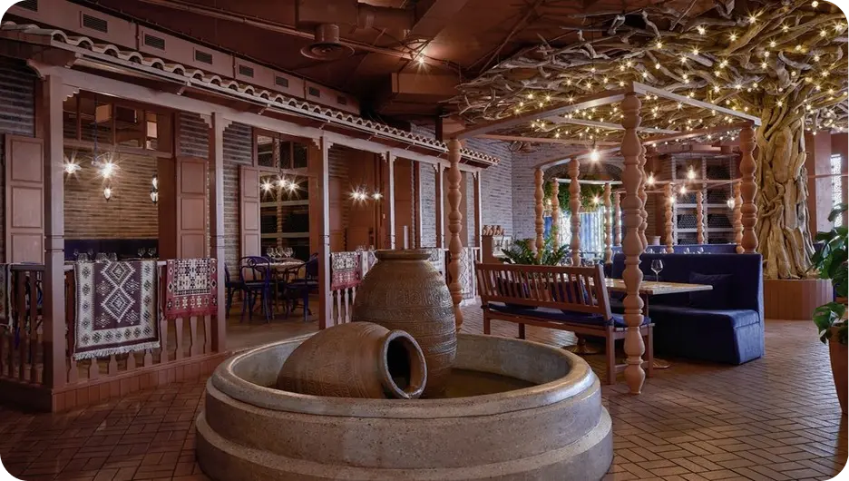
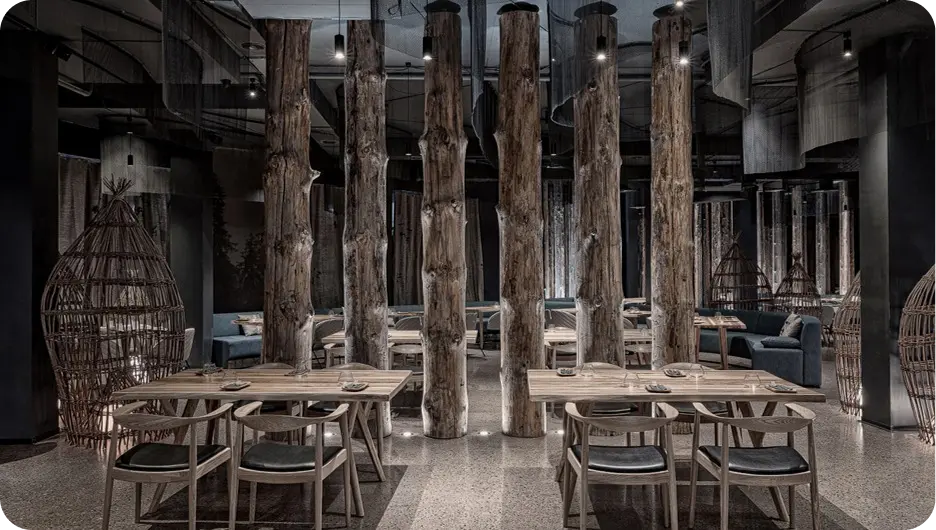

Я из Красноярска и особенно люблю его за сочетание сибирской природы и активной городской жизни. Енисей здесь виден почти отовсюду, а за пределами города начинаются сопки. Природа здесь — не отдельное направление для поездки на выходные, а часть повседневной жизни.

Вот несколько мест, которые советую посетить:

Татышев парк — большой зелёный остров в черте города. Здесь можно взять велосипед или просто погулять вдоль реки. А ещё в парке живут суслики, которые давно стали местными любимцами и одним из символов Красноярска.

Красноярские Столбы — заповедник с живописными скалами, куда красноярцы ездят с детства. Здесь есть маршруты разной сложности: можно отправиться в большой поход или просто дойти до первых скал, прогуляться и подышать свежим воздухом.

«Дзе» и «Тунгуска» — места, куда советую заглянуть за гастрономическими впечатлениями. В «Дзе» — приятная атмосфера и вкусная грузинская кухня, а в «Тунгуске» можно познакомиться с локальными сибирскими вкусами и попробовать что‑то новое.

Буду рада, если вы влюбитесь в Красноярск так же, как я!
